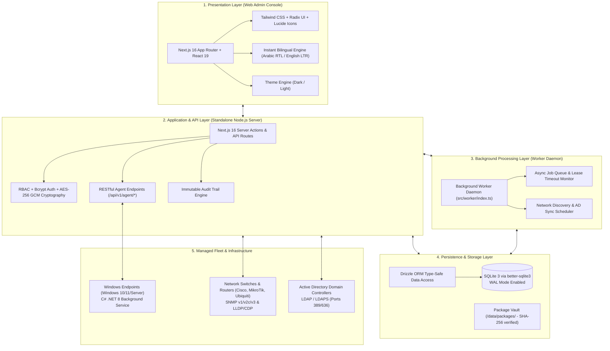
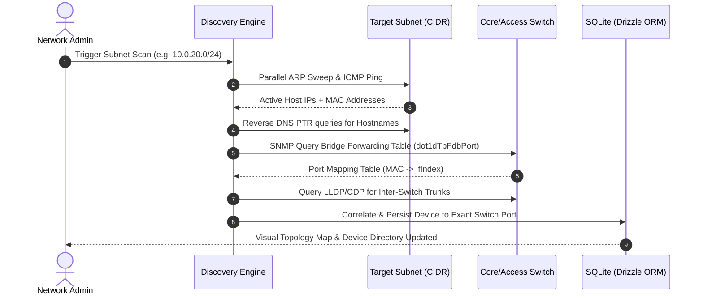
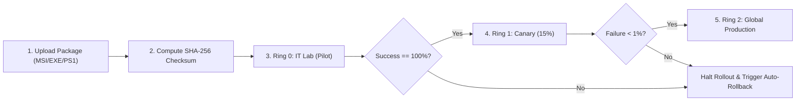
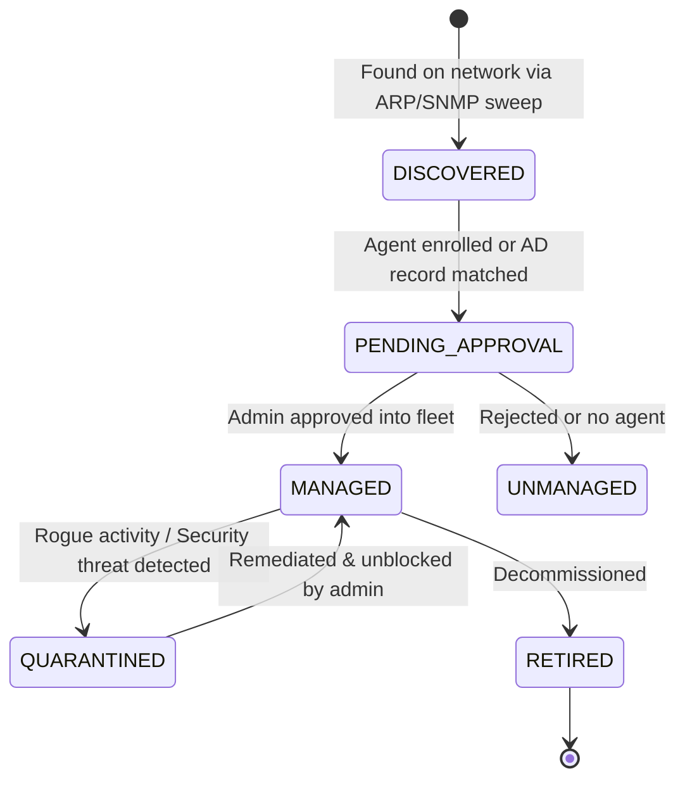

# 🌐 Enterprise IT Network & Endpoint Manager

[](https://nextjs.org/)
[](https://react.dev/)
[](https://www.typescriptlang.org/)
[](https://dotnet.microsoft.com/)
[](https://tailwindcss.com/)
[](https://www.sqlite.org/)
[](https://orm.drizzle.team/)
[](#license)

> **Next-Generation On-Premises Endpoint Management, Layer-2/Layer-3 Network Discovery, Canary Software Deployment, and Active Directory Fleet Orchestration Platform.**

---

## 📑 Table of Contents (فهرس المحتويات)

- [English Documentation](#-english-documentation)
  - [Executive Overview](#-executive-overview)
  - [Core Capabilities](#-core-capabilities)
  - [System Architecture](#-system-architecture)
  - [Core Workflow Diagrams](#-core-workflow-diagrams)
  - [Repository & Codebase Structure](#-repository--codebase-structure)
  - [Technology Stack](#-technology-stack)
  - [API Interface Directory](#-api-interface-directory)
  - [Getting Started & Quickstart](#-getting-started--quickstart)
  - [Enterprise Operations & Automation Scripts](#-enterprise-operations--automation-scripts)
  - [Verification & Quality Audit](#-verification--quality-audit)
- [التوثيق باللغة العربية (Arabic Documentation)](#-التوثيق-باللغة-العربية)
  - [نبذة عن المنظومة](#-نبذة-عن-المنظومة)
  - [المحركات والقدرات الأساسية](#-المحركات-والقدرات-الأساسية)
  - [معمارية وبنية النظام](#-معمارية-وبنية-النظام)
  - [دليل البدء والتشغيل السريع](#-دليل-البدء-والتشغيل-السريع)

---

# 🇺🇸 English Documentation

## 🔭 Executive Overview

**Enterprise IT Network & Endpoint Manager** is an enterprise-grade, single-tenant, on-premises management platform designed for modern IT administrators, network engineers, and security operations teams. It bridges the gap between **physical network infrastructure** (switches, routers, VLANs, and SNMP tables) and **endpoint fleet governance** (Windows client/server operating systems, software lifecycles, and Active Directory policies).

Unlike conventional cloud-tethered management tools, this platform is completely self-hosted, operates autonomously within restricted air-gapped corporate intranets, and delivers zero-latency observability over every port, packet, and machine in the enterprise.

---

## ⚡ Core Capabilities

### 1. 🗺️ Layer-2 & Layer-3 Network Discovery & Topology Mapping
* **Parallel Subnet Sweeper**: Scans CIDR subnets (e.g., `10.0.0.0/24`) using ultra-fast non-blocking ARP sweeps and ICMP pings.
* **Switch-Port Physical Correlation**: Interrogates Core/Access switches via SNMP (`dot1dTpFdbPort` Bridge MIB) to map host MAC addresses directly to physical switch ports (e.g., `Device WS-01 -> Switch Core-SW-01 -> Port Gi1/0/14`).
* **Topology & Trunk Link Tracking**: Reads LLDP/CDP neighbor tables to map multi-switch interconnections and trunk uplinks.
* **VLAN Segmentation**: Automatic identification of Access VLANs and 802.1Q Trunks.

### 2. 💻 Native Windows Endpoint Agent (.NET 8 C#)
* **Lightweight Background Service**: Installed as a native Windows service with ultra-low footprint (< 30 MB RAM).
* **Real-time Telemetry & Heartbeat**: Dispatches a 60-second telemetry payload including CPU/RAM load, active IP/MAC addresses, and currently logged-in interactive user.
* **Granular Hardware & Software Auditing**: Inspects CPU cores, physical memory DIMMs, storage partitions, BIOS serial numbers, and enumerates installed software products from the Windows Registry.
* **Remote Job Execution**: Polls for pending tasks and executes MSI, EXE (silent switches), and PowerShell automation scripts with complete exit code capture.

### 3. 🛡️ Emergency Endpoint Quarantine & Network Isolation
* **One-Click Instant Isolation**: Instantly isolates compromised or malware-infected devices directly from the web console.
* **WFP / Windows Firewall Rule Enforcement**: Drops all inbound and outbound LAN/WAN traffic, while preserving an exclusive encrypted TLS conduit back to the Endpoint Manager server for remediation and forensic inspection.

### 4. 📦 Software Packaging & Canary Rollout Engine
* **Secure Streaming Uploads**: Direct disk streaming for large installation binaries with automated cryptographic SHA-256 checksum verification.
* **Staged Canary Deployment Rings**:
  * **Ring 0 (IT Lab)**: Pilot rollout for validation and stability.
  * **Ring 1 (Canary 15%)**: Departmental evaluation with automated failure rate thresholds.
  * **Ring 2 (Production)**: Automated full-fleet propagation.
* **Atomic Job Lease Engine**: Leases software installation tasks for 15-minute windows with unique lease tokens. If a node drops offline, the background worker automatically releases the lease and flags the task for retry.

### 5. 🏢 Active Directory (LDAPS) & Rogue Detection
* **Continuous Directory Sync**: Syncs Computers, Users, and Organizational Units (OUs) via secure LDAP (port 636).
* **Rogue Workgroup Device Detection**: Cross-references physical switch MAC entries against AD domain computer records. Any unknown device plugged into an office port is flagged immediately as a **WORKGROUP / Rogue** node with automated alerts.
* **Remote Domain Join Orchestration**: Automatically creates the AD Computer object and dispatches an encrypted join command to the target node.

### 6. 🔐 Enterprise Security & Immutable Audit Trail
* **Role-Based Access Control (RBAC)**: Fine-grained roles (`SUPER_ADMIN`, `NETWORK_ADMIN`, `HELPDESK`, `AUDITOR`).
* **Hardware-Secured Secrets**: Passwords and SNMP community strings encrypted at rest using AES-256 GCM.
* **Agent Authentication**: Bcrypt-hashed pre-shared tokens with zero table-scan authentication (`Authorization: Bearer {agentId}:{secret}`).
* **Tamper-Evident Audit Logging**: Every administrative action, remote execution, and network change is permanently logged with originating IP, user, and timestamp.

### 7. 🎨 Ultra-Modern Bilingual UI / UX
* **Dual-Language Engine**: Instant one-click toggle between **Arabic (RTL)** and **English (LTR)** with zero layout shift.
* **Sleek Themes**: Polished Dark and Light modes using modern Radix UI primitives and Tailwind CSS.
* **Real-time Notifications**: Floating alerts for system events, job completions, and security warnings.

---

## 🏗️ System Architecture



---

## 🔄 Core Workflow Diagrams

### 1. Network Discovery & Switch-Port Physical Correlation


### 2. Software Deployment Canary Rollout Engine


### 3. Endpoint Lifecycle State Machine


---

## 📂 Repository & Codebase Structure

```
enterprise-it-network-manager/
├── .github/                       # GitHub Actions workflows & CI configurations
├── agent/                         # Native Windows Endpoint Agent (.NET 8 C#)
│   ├── src/
│   │   └── EndpointManagementAgent/
│   │       ├── Api/               # REST API HTTP Client & Bearer authentication
│   │       ├── Configuration/     # Agent settings & strongly-typed options
│   │       ├── Domain/            # Agent DTOs, contracts, and machine identity
│   │       ├── Inventory/         # Hardware & CPU/RAM/Disk inspection
│   │       ├── Jobs/              # Job execution, download manager & SHA-256 verifier
│   │       ├── Security/          # Windows Firewall / WFP isolation manager & DPAPI
│   │       ├── Software/          # Registry installed software enumerator
│   │       ├── Program.cs         # Service entry point & host configuration
│   │       └── Worker.cs          # 60s background loop (heartbeat + jobs poller)
│   ├── publish/                   # Pre-compiled standalone agent executable
│   └── EndpointManagementAgent.sln # Visual Studio / dotnet solution
├── docs/                          # In-depth architectural & verification reports
│   └── ENGINEERING_REPORT.md      # 438-line comprehensive master engineering audit
├── scripts/                       # PowerShell operational & automation runbooks
│   ├── Install-Server.ps1         # Automated server prerequisites & installation
│   ├── Start-Server.ps1           # Production service launcher (Web + Worker)
│   ├── Backup-Server.ps1          # Hot SQLite WAL backup & package snapshot
│   ├── Restore-Server.ps1         # Disaster recovery database & package restorer
│   ├── Test-ServerHealth.ps1      # Health check, memory, port & database audit
│   └── test-mvp-e2e.ts            # Automated End-to-End verification test suite
├── src/                           # Next.js 16 Application Root
│   ├── app/                       # App Router (27 fully-implemented routes)
│   │   ├── (dashboard)/           # Protected management console routes
│   │   │   ├── active-directory/  # AD Computers, Users, OUs, and Domain Join
│   │   │   ├── admin/             # User management, roles, system health & settings
│   │   │   ├── audit/             # Immutable audit trail explorer
│   │   │   ├── dashboard/         # Executive metrics & health widgets
│   │   │   ├── devices/           # Managed fleet inventory & device drill-down
│   │   │   ├── network/           # Discovery sweeps, topology map, VLANs & infrastructure
│   │   │   ├── reports/           # Compliance, asset exports & analytics
│   │   │   └── software/          # Software packages, canary deployments & approvals
│   │   ├── api/                   # REST API routes
│   │   │   ├── v1/agent/          # Agent communication endpoints (enroll, heartbeat, etc.)
│   │   │   ├── v1/reports/        # Export CSV/JSON reports
│   │   │   └── notifications/     # Real-time dashboard notification endpoints
│   │   ├── login/                 # Authentication portal
│   │   └── setup/                 # Initial system initialization wizard
│   ├── components/                # Reusable UI component library (shadcn/ui + Radix)
│   ├── lib/                       # Utilities, i18n dictionaries, and encryption helpers
│   ├── server/                    # Server-side business logic
│   │   ├── auth/                  # RBAC authorization & password hashing
│   │   ├── db/                    # Drizzle ORM schema definitions & migrations
│   │   └── services/              # AD, Discovery, Deployments & Audit services
│   └── worker/                    # Standalone background worker daemon
├── .env.example                   # Environment configuration template
├── drizzle.config.ts              # Drizzle ORM Kit configuration
├── package.json                   # Node.js dependencies & scripts
├── system_architecture_and_workflow.md # Complete architectural reference (Arabic)
└── tsconfig.json                  # TypeScript compiler configuration
```

---

## 🛠️ Technology Stack

| Layer | Technologies |
| :--- | :--- |
| **Frontend Framework** | **Next.js 16.3.4** (App Router, Server Actions, React Server Components) |
| **UI Library** | **React 19.2.8**, Radix UI Primitives, Lucide Icons |
| **Styling & Theming** | **Tailwind CSS 4.x**, Dark / Light Mode Engine |
| **Internationalization** | Built-in zero-dependency instant switcher (**Arabic RTL / English LTR**) |
| **Backend & APIs** | Node.js Standalone, Next.js API Routes, Streaming Binary Transfers |
| **Background Daemon** | Standalone Node.js Worker (`src/worker/index.ts`) with concurrency leasing |
| **Database & ORM** | **SQLite 3** (`better-sqlite3`) with **WAL Mode**, **Drizzle ORM 0.45** |
| **Endpoint Agent** | **C# .NET 8.0** Windows Service, Windows Filtering Platform (WFP), DPAPI |
| **Network Protocols** | Raw Sockets ARP, ICMP, SNMP v1/v2c/v3, LLDP, CDP, LDAPS (Port 636) |
| **Security & Crypto** | AES-256 GCM, Bcrypt, SHA-256 Checksums, JOSE JWT |

---

## 📡 API Interface Directory

### Windows Agent Interface (`/api/v1/agent/*`)
| Endpoint | Method | Functionality | Security Standard |
| :--- | :---: | :--- | :--- |
| `/api/v1/agent/enroll` | `POST` | First-time machine enrollment and secret generation | Pre-shared Enrollment Key |
| `/api/v1/agent/heartbeat` | `POST` | Transmits 60s telemetry, IP changes & logged-in user | Bearer Token `{agentId}:{secret}` |
| `/api/v1/agent/inventory` | `POST` | Reports deep hardware (CPU, RAM, Disks, BIOS) specs | Bearer Token + JSON Schema |
| `/api/v1/agent/jobs` | `GET` | Polls for pending deployment jobs & acquires 15m lease | Bearer Token + Atomic Lease |
| `/api/v1/agent/jobs/[id]/status` | `PATCH` | Reports job progress (`INSTALLING`, `SUCCESS`, `FAILED`)| Bearer Token + Active Lease Token |
| `/api/v1/agent/packages/[id]` | `GET` | Streams software package binary directly from disk | Bearer Token + SHA-256 header |
| `/api/v1/agent/software` | `POST` | Uploads installed software registry inventory | Bearer Token + Bulk Upsert |

### Administrative & Reporting Interface
| Endpoint | Method | Functionality |
| :--- | :---: | :--- |
| `/api/notifications` | `GET / PATCH / DELETE` | Fetches real-time alerts, mark as read, or dismiss |
| `/api/v1/reports/export` | `GET` | Exports fleet inventory and audit logs to CSV or JSON |

---

## 🚀 Getting Started & Quickstart

### Prerequisites
1. **Node.js**: `v20.x` or `v22.x` (LTS recommended)
2. **Package Manager**: `pnpm` (`v9.x` or higher) or `npm`
3. **Operating System**: Windows Server 2019/2022/2025 or Windows 10/11 (for full agent & network features)
4. **.NET SDK**: .NET 8.0 SDK (required only if building the agent from source)

---

### Step 1: Clone the Repository
```bash
git clone https://github.com/mahmoud-adel-dev/enterprise-it-network-manager.git
cd enterprise-it-network-manager
```

### Step 2: Install Node Dependencies
```bash
pnpm install
```

### Step 3: Configure Environment Variables
Copy the example environment file and customize the configuration:
```bash
copy .env.example .env.local
```
Generate a secure 64-character secret for `AUTH_SECRET`:
```bash
node -e "console.log(require('crypto').randomBytes(48).toString('hex'))"
```
Ensure your `.env.local` includes:
```ini
DATABASE_PATH=./data/endpoint-manager.sqlite
AUTH_SECRET=your_generated_secret_here
APP_BASE_URL=http://localhost:3000
PACKAGE_STORAGE_PATH=./data/packages
WORKER_CONCURRENCY=5
WORKER_POLL_INTERVAL_SECONDS=10
DISCOVERY_ENABLED=true
```

### Step 4: Run Database Migrations
Initialize the SQLite database and apply the Drizzle schema:
```bash
pnpm db:migrate
```

### Step 5: Start Development Servers
Start the Next.js web application and the background worker daemon in parallel:

**Terminal 1 (Web Application):**
```bash
pnpm dev
```

**Terminal 2 (Background Worker):**
```bash
pnpm worker
```

Open [http://localhost:3000](http://localhost:3000) in your browser. The initial setup wizard will guide you through creating the primary **Super Admin** account.

---

### Step 6: Building & Installing the Windows Agent
To compile the C# agent from source:
```cmd
cd agent
dotnet publish -c Release -r win-x64 --self-contained false -o ./publish
```
Or run the pre-configured build script:
```cmd
build-agent.cmd publish -c Release
```
Configure `agent/publish/appsettings.json` with your server URL and enrollment token:
```json
{
  "Agent": {
    "ServerUrl": "http://your-server-ip:3000",
    "EnrollmentToken": "YOUR_ENROLLMENT_TOKEN",
    "HeartbeatIntervalSeconds": 60
  }
}
```
Install the agent as a Windows Service (run as Administrator):
```cmd
sc.exe create "EndpointManagementAgent" binPath= "C:\Path\To\publish\EndpointManagementAgent.exe" start= auto
sc.exe start "EndpointManagementAgent"
```

---

## 🛡️ Enterprise Operations & Automation Scripts

The repository includes battle-tested PowerShell runbooks in the `scripts/` directory for production management:

| Script | Purpose | Command Example |
| :--- | :--- | :--- |
| **`Install-Server.ps1`** | Installs system prerequisites, checks firewall ports, and sets up directories. | `.\scripts\Install-Server.ps1` |
| **`Start-Server.ps1`** | Launches the production web server and background worker as background jobs. | `.\scripts\Start-Server.ps1` |
| **`Test-ServerHealth.ps1`** | Validates DB responsiveness, port binding, package storage, and memory health. | `.\scripts\Test-ServerHealth.ps1` |
| **`Backup-Server.ps1`** | Performs a non-blocking hot backup of the SQLite database and package store. | `.\scripts\Backup-Server.ps1 -BackupDir D:\Backups` |
| **`Restore-Server.ps1`** | Restores the database and packages from an archive with safety checks. | `.\scripts\Restore-Server.ps1 -Archive D:\Backups\backup.zip` |

---

## ✅ Verification & Quality Audit

The platform has undergone rigorous end-to-end testing and architectural auditing:

* **Automated E2E Tests**: **28 Passed, 0 Failed** (covering authentication, agent enrollment, software upload streaming, canary deployments, and network discovery).
* **TypeScript Compilation**: Clean type-checking (`npx tsc --noEmit` exits with **Code 0**).
* **Code Linting**: Zero ESLint violations (`npm run lint` exits with **Code 0**).
* **Production Build**: Fully optimized Turbopack build verified (`npm run build` exits with **Code 0**).
* **Documentation**: See [`docs/ENGINEERING_REPORT.md`](docs/ENGINEERING_REPORT.md) for the full 438-line technical verification report.

---

# 🇸🇦 التوثيق باللغة العربية

## 💡 نبذة عن المنظومة

**Enterprise IT Network & Endpoint Manager** هي منظومة متكاملة لإدارة الشبكات وأجهزة ونقاط النهاية المؤسسية داخل بيئة العمل المحلية (On-Premises)، صُممت خصيصاً للمؤسسات والشركات التي تتطلب **أعلى معايير الأمان والسرعة والاستقلالية التامة** دون الحاجة للاتصال بخدمات سحابية خارجية (Cloud-Independent).

تجمع المنظومة بين قدرات **إدارة أجهزة الحواسيب والخوادم** عبر عميل خفيف (Lightweight C# Agent) وبين **استكشاف وتحليل بنية الشبكة الفيزيائية** عبر محولات الشبكة (Switches) وبروتوكولات SNMP، مما يمنح مديري الأنظمة رؤية شاملة تمكّنهم من معرفة مكان كل جهاز، ومنفذ السويتش المتصل به، والبرامج المثبتة عليه، وحالته الأمنية بدقة متناهية.

---

## 🚀 المحركات والقدرات الأساسية

### 1. 🔍 محرك استكشاف الشبكة ورسم الطوبولوجيا (Network Discovery Engine)
- مسح فائق السرعة لشبكات الـ IP والشبكات الفرعية عبر حزم ARP و ICMP متوازية.
- قراءة جداول التوجيه في السويتشات عبر SNMP لربط عنوان الـ MAC الفيزيائي برقم المنفذ الفعلي (Switch Port Correlation).
- استخراج روابط السويتشات البينية عبر بروتوكولات LLDP و CDP لرسم خريطة الشبكة التفاعلية.
- كشف وتصنيف شبكات الـ VLANs (Access و Trunks).

### 2. 💻 عميل نقاط النهاية لنظام ويندوز (Windows Agent .NET 8)
- عميل يعمل كخدمة خلفية (Windows Service) باستهلاك موارد ضئيل جداً (< 30 ميجابايت رام).
- إرسال نبضات دورية (Heartbeat كل 60 ثانية) تشتمل على استهلاك الموارد، اسم المستخدم النشط، وعناوين الـ IP.
- جرد تفصيلي للعتاد (المعالج، الذواكر، الأقراص، الرقم التسلسلي للـ BIOS) وسجل البرامج المثبتة.
- تنفيذ الأوامر وحزم التثبيت الصامت (MSI / EXE / PowerShell) عن بُعد مع تسجيل أكواد الخروج (Exit Codes).

### 3. 🛡️ عزل الأجهزة المصابة فورياً (Endpoint Quarantine)
- إمكانية عزل أي جهاز مخترق أو مشبوه بضغطة زر واحدة من لوحة التحكم.
- تفعيل قواعد جدار حماية ويندوز (WFP / Firewall) لقطع الاتصال عن الشبكة المحلية والإنترنت مع الإبقاء فقط على مسار اتصال مشفر مع خادم الإدارة للمعالجة.

### 4. 📦 محرك حزم البرمجيات والنشر التدريجي (Canary Rollouts)
- رفع وتخزين ملفات التثبيت الضخمة مع التحقق التلقائي من بصمة التشفير (SHA-256).
- التوزيع عبر حلقات تدريجية (الحلقة 0 للمختبر ➔ الحلقة 1 للتجربة بنسبة 15% ➔ الحلقة 2 للإنتاج الشامل).
- التراجع التلقائي في حال تجاوز نسبة الأخطاء للحد المسموح به.
- نظام عقود التأجير (Job Leases) لمنع تعليق المهام عند انقطاع الاتصال بالأجهزة.

### 5. 🏢 التكامل مع الدليل النشط (Active Directory)
- مزامنة دورية للحواسيب، المستخدمين، والوحدات التنظيمية (OUs) عبر LDAPS.
- كشف الأجهزة المارقة (Rogue Workgroups) التي تتصل بسويتشات المؤسسة دون حساب دومين معتمد.
- إصدار أوامر الانضمام للدومين عن بُعد (Remote Domain Join).

### 6. 🌐 واجهة مستخدم ثنائية اللغة فائقة الحداثة
- دعم فوري للغتين **العربية (RTL)** و **الإنجليزية (LTR)** دون إعادة تحميل الصفحة.
- دعم الوضع الليلي والنهاري (Dark / Light Mode) وتصميم متجاوب مبني بـ Next.js 16 و React 19 و Tailwind CSS.

---

## 🏛️ معمارية وبنية النظام

تعتمد المنظومة على تصميم الطبقات المنفصلة (**Modular Layered Architecture**):
1. **طبقة العرض والواجهة**: متصفح الويب المبني بـ React 19 و Next.js 16 مع دعم RTL العربي.
2. **طبقة الخادم والتطبيقات**: خادم Node.js مستقل يوفر واجهات برمجية مشفرة ونظام صلاحيات صارم (RBAC).
3. **محرك المعالجة الخلفية (Worker Daemon)**: خدمة مستقلة لمعالجة طوابير المهام، فحص عقود التشغيل، والمسح الدوري.
4. **طبقة البيانات والتخزين**: قاعدة بيانات SQLite محلية مدمجة تعمل بنمط التدوين المسبق (WAL Mode) وسريعة جداً.
5. **الأسطول المدار**: عملاء ويندوز، محولات الشبكة، وخوادم الدليل النشط.

للاطلاع على التوثيق الهندسي المفصل باللغة العربية، يرجى مراجعة ملف [`system_architecture_and_workflow.md`](system_architecture_and_workflow.md).

---

## ⚡ دليل البدء والتشغيل السريع

### المتطلبات الأساسية
- بيئة تشغيل **Node.js** (الإصدار 20 أو 22 LTS).
- مدير الحزم **pnpm** أو **npm**.
- نظام تشغيل Windows (للاستفادة الكاملة من ميزات العميل ومسح الشبكات).

### خطوات التثبيت والتشغيل
```bash
# 1. استنساخ المستودع
git clone https://github.com/mahmoud-adel-dev/enterprise-it-network-manager.git
cd enterprise-it-network-manager

# 2. تثبيت الحزم البرمجية
pnpm install

# 3. إعداد ملف البيئة
copy .env.example .env.local

# 4. تطبيق تحديثات قاعدة البيانات
pnpm db:migrate

# 5. تشغيل خادم الويب وخادم المعالجة الخلفية
pnpm dev
# في نافذة طرفية أخرى:
pnpm worker
```

افتح المتصفح على الرابط: `http://localhost:3000` للدخول إلى معالج الإعداد الأولي وتسجيل حساب مدير النظام الرئيسي.

---

## 📄 License

This project is licensed under the [MIT License](LICENSE) - see the LICENSE file for details.

---

<div align="center">
  <sub>Developed & Architected by <strong><a href="https://github.com/mahmoud-adel-dev">Mahmoud Adel</a></strong>. Built for resilient, modern enterprise infrastructure.</sub>
</div>
