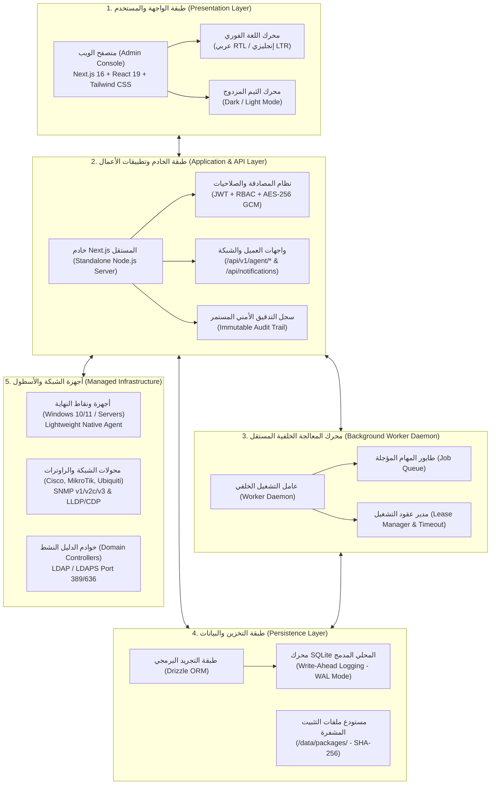
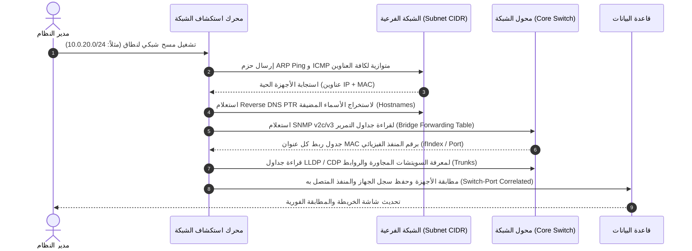
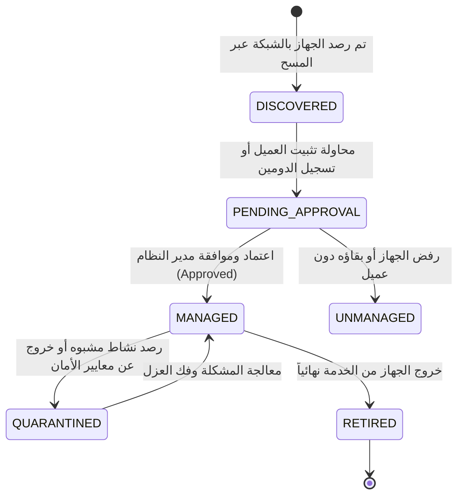
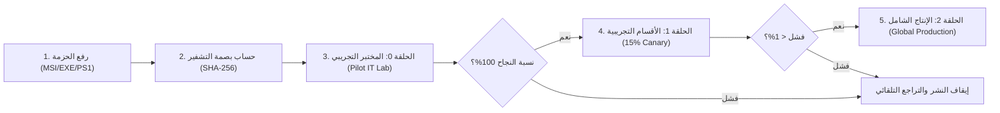
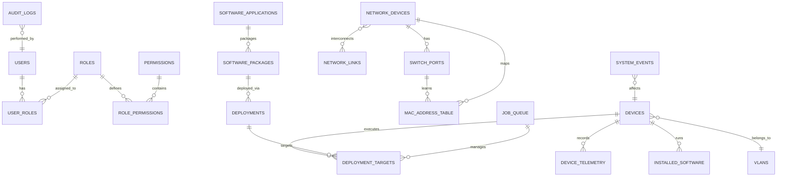

# دليل البنية المعمارية وطريقة العمل (System Architecture & Workflow Guide)
**منظومة Endpoint Manager — التوثيق الهندسي للبنية التحتية وآليات التشغيل**

---

## 1. المعمارية العامة للنظام (High-Level Architecture)

بُني نظام **Endpoint Manager** وفق معمارية الطبقات المنفصلة (**Layered Modular Architecture**) المصممة لتحقيق أقصى درجات الأداء والاستقرار مع انعدام الاعتماد على أي خدمات خارجية:

---

## 2. محركات العمل الرئيسية وكيف تعمل (Core Engines & Workflows)

---

### أولاً: محرك استكشاف الشبكة ورسم الطوبولوجيا (Network Discovery Engine)

يعمل هذا المحرك بشكل دوري أو عند الطلب لاكتشاف كافة الأجهزة المتصلة على مستوى طبقات الشبكة الثانية والثالثة (Layer-2 & Layer-3):

#### الخطوات الهندسية للمطابقة الفيزيائية:
1. **المسح المتوازي (Parallel Subnet Sweep):** يبث المحرك 254 طلب فحص فوري بدون إبطاء الشبكة باستخدام تقنية Raw Sockets مع الاستماع المباشر لاستجابات الـ ARP Frame.
2. **استنتاج المنفذ (MAC to Port Correlation):** عبر استعلام الـ OID القياسي `dot1dTpFdbPort`، يربط النظام عنوان الـ MAC الفيزيائي برقم المنفذ الفعلي على السويتش (مثلاً: `Gi1/0/5` متصل به الجهاز `WS-FIN-042`).
3. **ربط شبكات الـ VLAN:** قراءة وسم المنفذ (Access VLAN أو 802.1Q Trunk) وتحديد العزل المنطقي للجهاز.

---

### ثانياً: محرك إدارة أسطول نقاط النهاية (Endpoint Fleet & Agent Engine)

يتحكم النظام في دورة حياة الجهاز منذ لحظة اكتشافه وحتى اعتماده أو عزله:

#### بروتوكول اتصال العميل (Agent Communication Loop):
1. **التسجيل الذاتي (Enrollment):** يتصل العميل لأول مرة عبر المسار المأمون `/api/v1/agent/enroll` مقدماً رمز التسجيل المشفر (`EnrollToken`) مع معرّف الجهاز الفريد (`Device UUID`).
2. **نبضات القلب الدورية (Heartbeat every 60s):** يرسل العميل تحديثاً كل دقيقة إلى `/api/v1/agent/heartbeat` يتضمن عناوين الـ IP الحالية، المستخدم المسجل حالياً، وحالة استهلاك الموارد.
3. **جرد العتاد التفصيلي (Inventory Report):** إرسال تقرير شامل ببيانات المعالج (CPU Cores)، الذاكرة، الأقراص وسعتها، الأرقام التسلسلية للـ BIOS، والبرامج المثبتة.

---

### ثالثاً: محرك نشر وتوزيع البرمجيات (Software Packaging & Ring Rollout Engine)

يتيح النظام توزيع البرمجيات والاسكربتات التحديثية بنظام الحلقات المتدرجة (Canary Rings) لضمان عدم توقف الأعمال:

#### آلية التأجير وضمان عدم التعليق (Job Lease Mechanism):
- عندما يطلب العميل مهمة من `/api/v1/agent/jobs`، يُمنح **عقد تأجير مؤقت (Lease)** مدته 15 دقيقة مسجل برمز سري (`LeaseToken`).
- إذا انقطع اتصال الجهاز ولم يرسل تحديثاً لحالة التثبيت، يقوم **العامل الخلفي (Worker)** تلقائياً بإلغاء الحجز وإعادة إدراج المهمة في الطابور (`RETRY_PENDING`) وتسجيل تنبيه في سجل التدقيق.

---

### رابعاً: محرك التكامل مع الدليل النشط (Active Directory Integration)

يتصل النظام مباشرة بوحدات التحكم في النطاق (Domain Controllers) عبر بروتوكول LDAP:
1. **مزامنة الكائنات (Directory Sync):** قراءة كائنات الحواسيب (`computer`) والمستخدمين (`user`) والوحدات التنظيمية (`organizationalUnit`).
2. **كشف الأجهزة المارقة (Rogue Workgroup Detection):** يقارن النظام باستمرار بين عناوين الـ MAC المرصودة على السويتشات وسجلات الـ AD. أي جهاز لا يملك حساباً مسجلاً في النطاق يتم تمييزه فوراً بـ **WORKGROUP** ويصدر له تنبيه أمني لعزله أو ضمه.
3. **أمر الانضمام عن بُعد (Remote Domain Join Trigger):** إنشاء حساب كمبيوتر مسبق في الـ OU المستهدفة، وإرسال أمر مشفر للعميل لتنفيذ أمر `Add-Computer` وإعادة التشغيل المنظمة.

---

## 3. خريطة مسارات واجهات البرمجة (API Interface Directory)

توفر المنصة واجهات RESTful مشفرة وسريعة تلبي كافة الاحتياجات:

### واجهات عميل نقطة النهاية (`/api/v1/agent/`):
| المسار (Endpoint) | الطريقة (Method) | الوظيفة الهندسية | معايير الأمان |
| :--- | :---: | :--- | :--- |
| `/api/v1/agent/enroll` | `POST` | تسجيل الجهاز الجديد وإصدار جلسة تشغيل مشفرة | التحقق من صحة `EnrollToken` ومطابقة الـ UUID |
| `/api/v1/agent/heartbeat` | `POST` | تأكيد الاتصال وتجديد حالة الـ Online وتحديث الـ IP | التحقق من هوية الجهاز عبر Bearer Token |
| `/api/v1/agent/inventory` | `POST` | تسليم تقرير تفاصيل العتاد ونظام التشغيل والمستخدم | التحقق من صحة مخطط الـ JSON وتحديث السجلات |
| `/api/v1/agent/jobs` | `GET` | استعلام العميل عن أي حزم برمجية أو مهام مجدولة له | نظام حجز المهام (Lease Token) المؤقت |
| `/api/v1/agent/jobs/[id]/status`| `PATCH` | إفادة الخادم بحالة التقدم (`INSTALLING` / `SUCCESS` / `FAILED`) | التأكد من امتلاك العميل لنفس عقد التأجير الساري |
| `/api/v1/agent/packages/[id]` | `GET` | تحميل ملف التثبيت المصدري بصيغة دفق ثنائي (Binary Stream) | دفق مباشر مع التحقق المسبق من بصمة التشفير |
| `/api/v1/agent/software` | `POST` | رفع قائمة البرامج المثبتة على الجهاز لتدقيق التراخيص | تحديث جدول البرمجيات المركزية |

### واجهات لوحة التحكم والتقارير:
| المسار (Endpoint) | الطريقة (Method) | الوظيفة الهندسية |
| :--- | :---: | :--- |
| `/api/notifications` | `GET / PATCH / DELETE` | سحب الإشعارات اللحظية، وتحديدها كمقروءة، وحذف المنتهي |
| `/api/v1/reports/export` | `GET` | تصدير تقارير الأجهزة والتدقيق بصيغ CSV و JSON |

---

## 4. مخطط كيانات قاعدة البيانات (Database Entity-Relationship Model)

### الجداول الجوهرية في النظام:
- **`devices`**: السجل المركزي لكافة مواصفات الحواسيب، المعالجات، الذاكرة، الأقراص، وحالات الانضمام للدومين.
- **`network_devices`**: السويتشات والراوترات ومجتمعات SNMP ومواقعها الجغرافية ورفوف الخوادم (Racks).
- **`switch_ports`**: منافذ السويتش، السرعات، وأنماط الـ Duplex والـ VLANs المرتبطة بها.
- **`mac_address_table`**: جدول توجيه عناوين الماك الذي يربط منفذ السويتش بجهاز الحاسوب الفعلي.
- **`deployments` & `deployment_targets`**: سجل مهام نشر الحزم وحلقات التوزيع ومعدلات النجاح.
- **`audit_logs`**: السجل الأمني المالي والصارم لكل تعديل وحذف وإضافة مع الـ IP واسم المنفذ.

---

## 5. دليل إجراءات التشغيل للمسؤولين (SysAdmin Runbook)

### 1. إضافة سويتش شبكة جديد وتفعيل قراءة المنافذ:
1. الدخول إلى: **الشبكة والبنية التحتية ➔ أجهزة الشبكة والمحولات** (`/network/infrastructure`).
2. الضغط على **"إضافة جهاز جديد"** وإدخال عنوان الـ IP (مثلاً: `10.0.10.2`) وتحديد النوع `SWITCH`.
3. تفعيل خيار **SNMP** وتحديد الإصدار (`v2c` أو `v3`) وإدخال كلمة المجتمع (Community) أو بيانات الاعتماد المشفرة.
4. سيقوم النظام خلال 30 ثانية بقراءة جميع المنافذ وجداول الـ MAC Address وعرضها تلقائياً.

### 2. تنفيذ مسح شامل لشبكة فرعية (Subnet Sweep):
1. الانتقال إلى: **استكشاف وفحص الشبكة ➔ بدء فحص جديد** (`/network/discovery/new`).
2. إدخال نطاق الـ CIDR (مثلاً `10.0.20.0/24`) واختيار بروفايل الـ SNMP.
3. الضغط على **"بدء المسح"**؛ وستظهر الأجهزة المكتشفة في قائمة الانتظار للموافقة عليها بضغطة زر.

### 3. إنشاء حزمة برمجية وتوزيعها عبر حلقات النشر:
1. الانتقال إلى: **البرمجيات والتطبيقات ➔ دليل التطبيقات** (`/software/applications`).
2. الضغط على **"إضافة تطبيق جديد"** ورفع ملف التثبيت الصامت (MSI/EXE).
3. تحديد وسيطات التثبيت الصامت (مثلاً: `/qn /norestart`).
4. الانتقال إلى **عمليات التوزيع** وإنشاء حلقة نشر تبدأ بمجموعة الـ IT Lab ثم الأقسام العامة.
